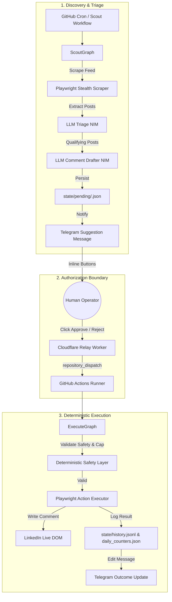
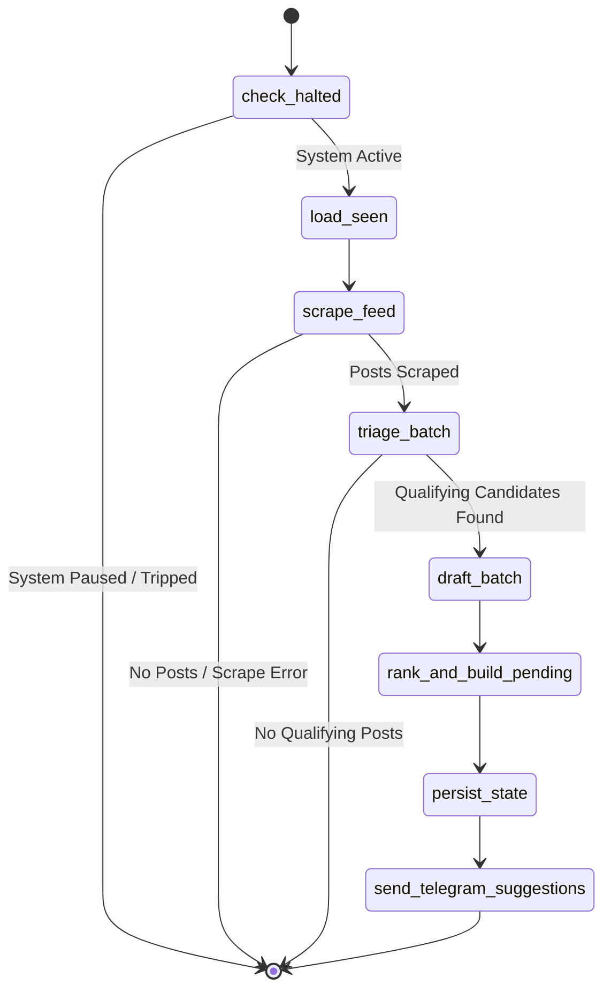
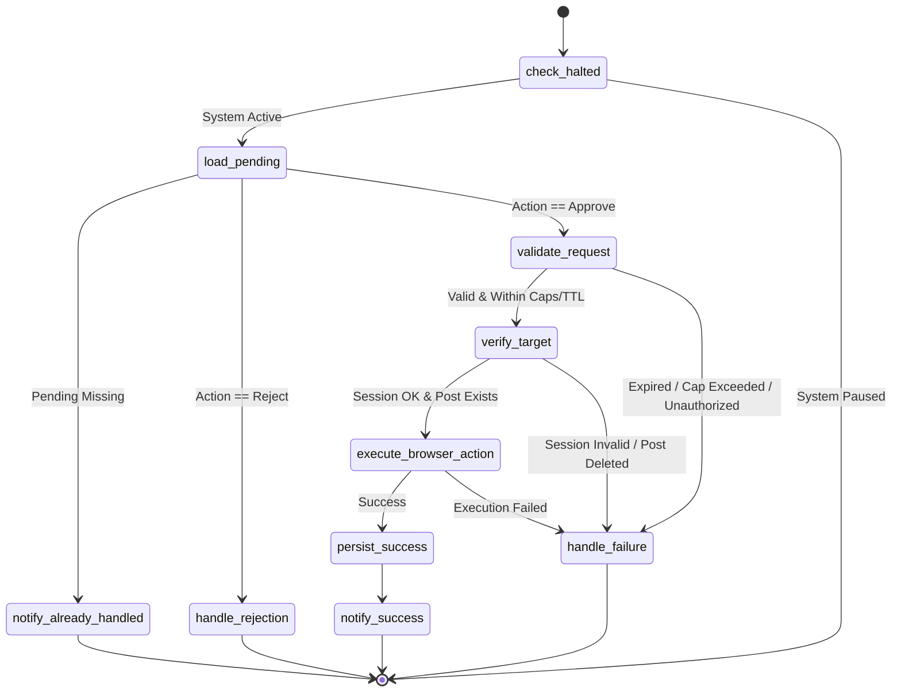
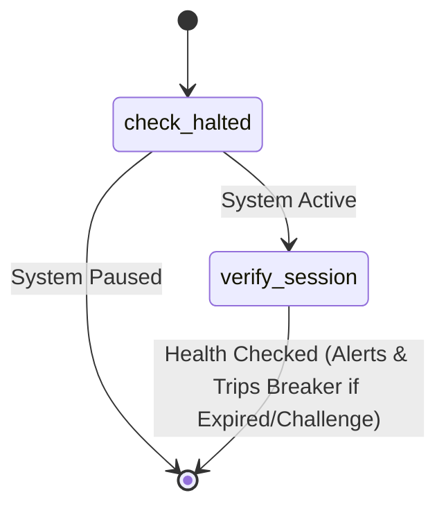
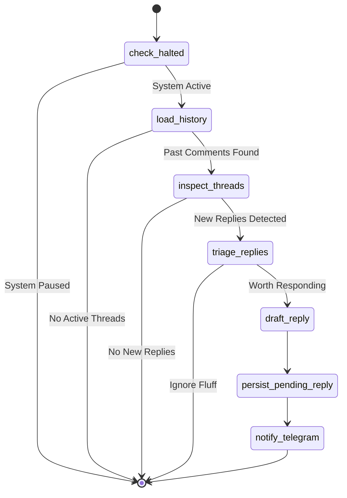
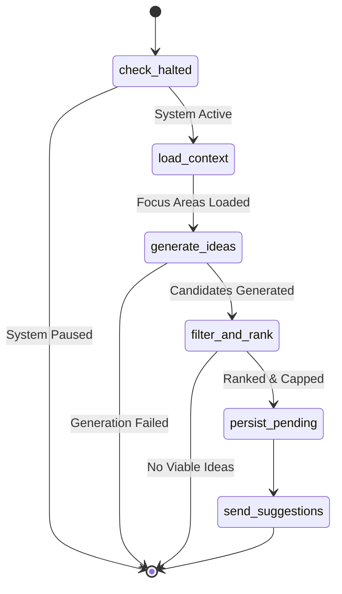

# System Architecture & Technical Design

This document details the architectural design, workflow state machines, persistence model, and safety mechanisms of LinkedAide.

---

## 1. System Overview

The system bridges scheduled autonomous discovery with strict human supervisory control:

---

## 2. Core Architectural Invariants

1. **Human Approval is Mandatory**: No LinkedIn write action (commenting, posting, reacting) may occur without explicit authorization from the configured Telegram user.
2. **LangGraph Workflow Orchestration**: Business logic and branching transitions are orchestrated via deterministic LangGraph state graphs.
3. **LangChain for Structured LLM Operations**: All model interactions are centralized through `LLMService` using LangChain and NVIDIA NIM, with strict Pydantic schema validation.
4. **Deterministic Safety Policy**: Rate limits, daily caps, approval TTLs, circuit breakers, and sender checks are implemented in code—never entrusted solely to LLM prompts.
5. **Durable Repository State**: All application state resides in version-controlled JSON/JSONL records in `state/`.

---

## 3. Workflow State Machines (LangGraph)

The application defines five compiled LangGraph state machines:

### 3.1 ScoutGraph
Orchestrates feed ingestion, LLM evaluation, and suggestion delivery:

### 3.2 ExecuteGraph
Executes human approval or rejection events received via `repository_dispatch`:

### 3.3 HealthCheckGraph
A lightweight canary workflow that runs periodically to verify LinkedIn session validity without performing feed scraping or LLM calls:

### 3.4 ThreadMonitorGraph
Monitors comment threads on previously engaged posts to detect replies, triage discussion context, draft conversational follow-ups, and deliver Telegram cards for approval:

### 3.5 IdeationGraph
Orchestrates brainstorming and drafting original LinkedIn thought leadership posts based on configured focus areas and industry context:

---

## 4. LLM Service & Structured Output

LLM integration is managed by `LLMService` in `src/agent/llm/service.py`:

- **Provider**: NVIDIA NIM via LangChain (`ChatNVIDIA`), with multi-provider fallbacks (OpenAI, Anthropic, Gemini, Groq, Ollama).
- **Two-Stage Evaluation**:
  1. **Triage**: High-speed, cost-effective evaluation of scraped posts against configured `USER_FOCUS_AREAS`, `SCOUT_TARGET_URLS`, `TARGET_HASHTAGS`, and `USER_PERSONA`. Produces a structured `TriageResult` (`recommendation: "comment" | "ignore"`, `confidence`, `reasoning`, `risk_flags`).
  2. **Drafting**: Deep generation producing `CommentDraft` with strict anti-generic constraints, specific professional insights, and character length bounds.
- **Resilience & Fallback**:
  - Primary model: `meta/llama-3.3-70b-instruct`
  - Fallback model: `openai/gpt-oss-20b`
  - Automatic fallback on rate-limits (HTTP 429), timeouts, or provider 5xx errors.

---

## 5. Durable State Persistence Model (Cloudflare KV & Git Fallback)

State persistence is abstracted via `BaseStateStore` (`src/agent/state/base.py`) with two implementations:

### 5.1 Cloudflare KV State Backend (`CloudflareKVStateStore`)
The primary production backend (`STATE_BACKEND=kv`). State records are persisted in a private Cloudflare Workers KV namespace via the REST API (`api.cloudflare.com/client/v4`):

- `pending:{item_id}` -> JSON string of `PendingAction`
- `seen_posts` -> JSON map of `content_hash -> iso timestamp`
- `history` -> JSON array of `HistoryEntry` audit logs
- `daily_counters` -> JSON of `DailyCounters` (auto-rollover on UTC date boundary)
- `incident` -> JSON of circuit breaker incident record (or 404 when normal)
- `paused` -> JSON of remote operator pause state

**Architectural Advantages of Cloudflare KV:**
- **Zero Git Merge Conflicts**: Eliminates concurrent push collisions between scheduled scout runs and approval dispatches.
- **Privacy on Public Repositories**: Keeps pending drafts, evaluated post excerpts, and operator history private inside Cloudflare KV rather than committed to a public Git repository.
- **Fast-Path Rejections**: The Cloudflare Telegram relay worker directly updates KV upon operator rejection, removing the need to spin up a GitHub Actions runner (saving CI minutes).
- **Clean Git History**: Prevents thousands of automated `chore(state): ... [skip ci]` commits from polluting git history.

### 5.2 Git-as-Database Fallback (`GitStateStore`)
Used for local offline development and testing (`STATE_BACKEND=git`):
- `state/pending/{item_id}.json`
- `state/seen_posts.json`
- `state/history.jsonl`
- `state/daily_counters.json`
- `state/incident.json`
- `state/paused.json`

The local `state/` directory is in `.gitignore` to prevent committing operational state when working locally.

### 5.3 Cloudflare R2 Media Vault
For durable storage of visual post assets and audit artifacts:
- **Post Assets**: Images and multi-slide Carousel PDFs drafted in the Post Composer Studio are uploaded via `/api/media/:key` directly to Cloudflare R2 and referenced with secure bearer tokens.
- **Audit Screenshots**: Post-execution screenshots captured by Playwright in GitHub Actions are uploaded directly to the R2 media vault, providing durable visual proof of every published comment and post.

---

## 6. Browser Automation & Stealth

The browser layer (`src/agent/browser/`) is the sole subsystem that interacts with LinkedIn:

- **Playwright Chromium**: Executes in headless mode with realistic viewport configurations, randomized natural delay jitter, and stealth navigator property overrides.
- **Ephemeral Session Decryption**: The encrypted storage state (`LINKEDIN_SESSION_STATE_ENC`) is decrypted into memory/runner-local temporary storage during execution and deleted in `finally` blocks.
- **No Autonomous Writes**: Scraper only reads from DOM; Executor only writes when an explicit, verified `ExecuteGraph` step instructs it.
- **Challenge Detection**: Automatically detects CAPTCHAs, email verification checkpoints, or security gates, instantly raising `BotDetectionError` and halting the workflow.

---

## 7. Deterministic Safety & Policy Enforcement

Safety rules are enforced by independent modules (`src/agent/safety/`):

1. **Daily Action Limiter (`RateLimiter`)**: Strictly limits comments and posts per day based on `daily_counters.json`.
2. **Approval TTL**: Pending suggestions expire after `PENDING_ACTION_TTL_HOURS` (default: 12 hours) to avoid executing stale commentary on old feed discussions.
3. **Idempotency & Duplicate Protection**: Each pending item has an 8-character hex hash. Once executed or rejected, the pending file is consumed and deleted; duplicate `repository_dispatch` events are safely ignored.
4. **Circuit Breaker (`CircuitBreaker`)**: Tripped immediately upon detection of bot challenges, session invalidation, or consecutive failure thresholds. When active, all subsequent runs abort immediately until manually reset.
5. **Dry-Run Mode**: Setting `DRY_RUN=true` executes full scraping, triage, drafting, and Telegram suggestion delivery, but mocks out DOM submission.

---

## 8. Telegram Interactive Webhook & C2 Engine

The Cloudflare Worker relay (`infra/telegram-relay-worker`) serves as the edge authorization and command-and-control gateway:

- **Interactive Message Replies**: Operators can reply directly to any suggestion card with revised draft text or tone keywords (`contrarian`, `data_driven`, `concise`, `inquisitive`, `supportive`). The worker leverages LLM capabilities to regenerate drafts on the fly and updates the Telegram card live.
- **Dedicated Callback Codes**: Compact callback codes (`ac`/`rc` for comments, `ap`/`rp` for posts, `ar`/`rr` for thread replies, `acon`/`rcon` for connection requests).
- **Command & Control (C2) Suite**:
  - `/status` — Realtime system health, circuit breaker state, and daily quota counts.
  - `/pending` — Interactive summary list of actions currently awaiting operator review.
  - `/stats` — Daily activity counters and all-time execution vs rejection approval metrics.
  - `/pause` / `/resume` — Remote kill-switch for automated operations.
  - `/clear_incident` — Remote reset for tripped circuit breakers.
  - `/help` — Operator command and syntax reference.

---

## 9. Desktop HITL Cockpit Architecture

The desktop application (`desktop/`) is built on Electron, React, and Tailwind CSS:

- **Dual Execution Engine**:
  - **Cloud Mode**: Synchronizes with Cloudflare Workers KV and triggers GitHub Actions cloud runners for execution.
  - **Local Mode**: Executes Playwright automation and CLI flows directly on the operator's machine via local Python runners.
- **Post Composer Studio**: Above-the-fold cutoff indicators, hook archetype generator, multi-slide carousel PDF previewer, and durable R2 media upload bridge.
- **Interactive Command Palette (⌘K)**: Spotlight-style search modal with real-time fuzzy filtering across all views and instant action triggers.
- **Tab Navigation History**: Browser-style history stack with functional back and forward buttons in the top control bar.
- **Embedded Diagnostic Runner**: Direct IPC bridge to execute `uv run agent doctor`, streaming live terminal output and check statuses into the UI.

